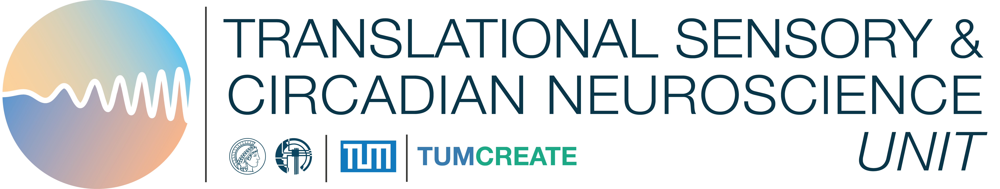

```{python}
#| label: load-literature
#| include: false
import html
import json
from collections import Counter
from datetime import date
from pathlib import Path

library = json.loads(Path("data/library.json").read_text(encoding="utf-8"))
from scripts.audit_search import rebuild
rebuild()
audit = json.loads(Path("data/search-audit.json").read_text(encoding="utf-8"))
studies = library["studies"]
devices = library["devices"]
esc = lambda value: html.escape(str(value), quote=True)
counts = Counter(study["status"] for study in studies)
updated = date.fromisoformat(library["updated"]).strftime("%d %B %Y")
assert len({study["id"] for study in studies}) == len(studies)
assert len({study["doi"].casefold() for study in studies}) == len(studies)
for study in studies:
    assert set(study["deviceMetrics"]) == set(study["devices"])
    assert {metric for values in study["deviceMetrics"].values() for metric in values} == set(study["metrics"])
    assert study["sourceLocator"]
```

```{=html}
<div class="doc-shell">
<a class="skip-link" href="#main-content">Skip to page content</a>
<header class="doc-header">
  <a class="brand" href="index.html"></a>
  <nav class="nav-links" aria-label="Main navigation">
    <a href="index.html">Directory</a>
    <a href="evidence.html" aria-current="page">About</a>
    <a href="https://tscnlab.org/">Unit website ↗</a>
  </nav>
</header>
<main class="doc-content" id="main-content">
<h1>About this directory</h1>
<p class="doc-lead">Scope, sources and curation methods for the light logger validation directory.</p>
```

```{python}
#| label: inventory-status
#| output: asis
print(f'<p class="audit-stamp">Literature checked {esc(updated)} · '
      f'{len(studies)} studies · {len(devices)} device entries · '
      f'{counts.get("Peer reviewed", 0)} peer reviewed · '
      f'{counts.get("Preprint", 0)} preprints · '
      f'{counts.get("Conference paper", 0)} conference paper</p>')
```

## Reading the directory

Each square represents one validation study for that device. Orange hatching marks documented developer involvement. Green checks show confirmed photopic illuminance and melanopic EDI outputs; the angle-dependence check means this property has been tested. Counts are not accuracy ratings.

Manufacturers and research developers group related models. Results remain specific to each tested model. “Commercial model” and “Research device” describe the instruments in the cited literature, rather than current purchasing availability.

Output capability and validation are stored separately, with literature sources. A dash means capability has not been established in the inspected sources. Checked independent authorship is noted in study details; unhighlighted squares do not imply independence.

## Scope

This directory includes primary studies with extracted direct tests of photopic illuminance, melanopic EDI or angle dependence. Indoor/outdoor and light-source classification papers are excluded unless the paper separately tests one of those three measurements. Placement-only, spectral-only, dose-only and other-endpoint papers are outside this scope. The expanded search is documented below. It is not an exhaustive systematic review: some known candidates still need extraction, and the search can miss relevant work.

Development papers are included when they report measurement tests. Each entry states the evidence type, reference, source access and limits. Inclusion does not certify a device. Reference comparisons, between-device agreement, repeatability and wearing-position studies are labelled separately; they do not provide interchangeable evidence of absolute accuracy.

Sources are research publications and explicitly labelled preprints. Manufacturer specifications and marketing claims are not used as validation evidence. Studies concerned only with sleep, activity, or physiological outcomes do not establish the accuracy of a device's light sensor and are outside this collection's measurement scope.

## Literature search

```{python}
#| label: search-accounting
#| output: asis
a = audit["accounting"]
print(f'<p>On {esc(updated)}, three Europe PMC queries returned '
      f'{a["retrievedAcrossQueries"]} records, or {a["uniqueBibliographicRecords"]} unique database accessions. '
      f'A title prefilter retained {a["titlePrefilterRetained"]} titles for inspection. '
      'Selected candidates were then checked against primary abstracts or full texts. '
      'Named-device searches, publisher and institutional records, and backward citation checking supplemented these queries.</p>')
print(f'<p>The directory contains {len(studies)} papers. '
      f'{sum(s["access"] == "Abstract" for s in studies)} currently rely on abstracts; '
      f'{sum(s["access"] == "Partial full text" for s in studies)} uses a partial full-text passage. '
      'The included-paper count is not the number of search hits screened, and does not imply exhaustive coverage.</p>')
print('<details class="audit-disclosure"><summary>Exact database queries and counts</summary>')
for q in audit["queries"]:
    print(f'<p><strong>{q["hits"]} records, all retrieved.</strong> '
          f'<a href="{esc(q["file"])}">Saved response</a></p><pre class="search-query">{esc(q["query"])}</pre>')
print('</details>')
```

Europe PMC includes PubMed/MEDLINE and indexed preprints. Search results were deduplicated by database source and accession; the included inventory has unique DOIs. The title prefilter, per-title dispositions and source-check decisions are available below. Records omitted by that prefilter were not manually screened. Three broader pilot searches were capped at 1,000 results each and are excluded from these counts.

Citation checking used the [V3 framework](https://doi.org/10.1177/20552076221144858), a [2025 light-device survey](https://doi.org/10.1016/j.buildenv.2025.112771), the [myopia light-meter review](https://doi.org/10.2147/OPTH.S420631), and references in primary papers. Reviews helped identify sources; their device specifications were not treated as validation results.

Limitations include English search terms, the title prefilter, no subscription-database search, indexing delays, incomplete access to older papers, and no independent second screening. Theses and conference abstracts have not been comprehensively assessed. A missing entry does not mean that a device has no validation evidence.

[Search audit (JSON)](data/search-audit.json) · [Title triage (CSV)](data/title-triage.csv) · [Source decisions (CSV)](data/search-decisions.csv)

```{python}
#| label: candidate-decisions
#| output: asis
print('<details class="audit-disclosure"><summary>Other candidates, unresolved papers and scope decisions</summary>')
for item in audit["otherCandidates"]:
    title = esc(item["citation"])
    if item["url"]:
        title = f'<a href="{esc(item["url"])}">{title} ↗</a>'
    print(f'<div class="candidate-record"><h3>{title}</h3><p><strong>{esc(item["decision"])}</strong>. '
          f'{esc(item["reason"])}</p><p class="model-note">Source checked: {esc(item["sourceInspected"])}</p></div>')
print('</details>')
```

## How to read an entry

- **Device model.** Evidence applies to the model named in the paper. Related models and later hardware or firmware versions may perform differently.
- **Tested measurement.** Photopic illuminance, melanopic quantities, spectral response, angular response, and other endpoints answer different questions. Outdoor classification concerns identifying environments rather than absolute illuminance accuracy. Tests of one endpoint do not establish accuracy for another.
- **Conditions.** Reference instruments, light sources, intensity ranges, sensor orientation, and body position affect how results can be used.
- **Publication and source access.** Preprints may not have undergone peer review. Abstract-only records provide less methodological detail than full-text records.
- **Study counts.** Counts describe the papers included here. No cross-study accuracy ranking or pooled estimate is calculated.

**Device names.** LYS and LYS Button are one device entry; the name used in each paper is retained where relevant. Other unresolved versions remain explicitly labelled. “Device entries” includes prototypes, unnamed models and one group of seven anonymised dosimeters; it is not a count of distinct commercial models.

**Publication images.** Journal and preprint-server marks identify sources. Where a journal-specific asset was unavailable, a publisher logo or the journal's name is used. Covers identify the venue, not necessarily the paper's issue. Device images are not shown.

## Curation and updates

Records contain a citation, persistent source link, tested device names, measurement categories, setting, reference, protocol summary, findings, limitations, and a locator for the supporting source passage, table or figure. Device-specific endpoint mappings prevent tests reported for one model from being assigned to every model in the same paper. Summaries are brief paraphrases; consult the original paper for numerical results, uncertainty, and complete methods. A paper may include several devices, so study counts and device counts are different units.

```{python}
#| label: publication-year-policy
#| output: asis
print(f'<p><strong>Publication years.</strong> {esc(library["yearPolicy"])}</p>')
```

Use **Submit a validation** on the directory to suggest a paper. A curator should check the source, model, methods, review status and conclusions before adding it. Submissions are not added automatically. New versions of a preprint should update the existing record rather than be counted as independent studies.

## Reproduce and reuse

The website and this notebook read the same versioned [JSON inventory](data/library.json). Rendering <a href="index.qmd" download data-noresolveinput>the directory notebook</a> rebuilds the interface and downloadable records; this notebook regenerates the provenance inventory below. The build does not query websites or change the literature records. Search and filters run in the visitor's browser.

The CSV preserves the study summaries and device-specific endpoint mappings. The BibTeX export contains partial citation metadata: title, DOI, URL and the indexed year. Abbreviated display authors are preserved in the note field rather than represented as a complete author list. Resolve the DOI for complete author, journal and publication-date metadata before using the export in a manuscript.

[Download the study table (CSV)](data/validations.csv) · [Download citations (BibTeX)](data/references.bib) · <a href="evidence.qmd" download data-noresolveinput>Download this notebook</a>

## Study inventory

```{python}
#| label: audit-inventory
#| output: asis

for study in sorted(studies, key=lambda item: (-item["year"], item["authors"])):
    source_url = study["url"]
    assert source_url.startswith("https://"), "Evidence links must use HTTPS."
    identifier = esc(study["id"])
    title = esc(study["title"])
    publication_status = esc(study["status"])
    access = esc(study.get("access", "Source linked"))
    print(f'<article class="evidence-record" id="{identifier}">')
    print(f'<p class="eyebrow">{esc(study["authors"])} · {study["year"]} · {publication_status}</p>')
    print(f'<h3><a href="{esc(source_url)}">{title} ↗</a></h3>')
    print('<dl class="audit-table">')
    fields = [
        ("Journal / server", library["venues"][study["venue"]]["name"]),
        ("Devices", "; ".join(study["devices"])),
        ("Measurements", "; ".join(study["metrics"])),
        ("Device-specific coverage", " | ".join(
            f'{device}: {", ".join(study["deviceMetrics"][device])}'
            for device in study["devices"]
        )),
        ("Setting", study["setting"]),
        ("Evidence type", study["evidenceType"]),
        ("Reference", study["reference"]),
        ("Protocol", study["protocol"]),
        ("Reported findings", study["finding"]),
        ("Limits of interpretation", study["limitations"]),
        ("Source inspected", study.get("access", "Source linked")),
        ("Evidence location", study["sourceLocator"]),
    ]
    if study.get("notes"):
        fields.append(("Curation note", study["notes"]))
    for label, value in fields:
        print(f'<div><dt>{esc(label)}</dt><dd>{esc(value)}</dd></div>')
    print('</dl>')
    doi = esc(study["doi"])
    print(f'<p class="citation-link"><a href="https://doi.org/{doi}">DOI: {doi}</a></p>')
    if study.get("pubmedUrl"):
        print(f'<p class="citation-link"><a href="{esc(study["pubmedUrl"])}">PubMed record ↗</a></p>')
    if study.get("fullTextUrl"):
        print(f'<p class="citation-link"><a href="{esc(study["fullTextUrl"])}">Full text ↗</a></p>')
    print('</article>')
```

```{=html}
</main>
<footer class="doc-footer">
  <a href="index.html">Directory</a>
  <a href="https://tscnlab.org/">Unit website ↗</a>
</footer>
</div>
```
